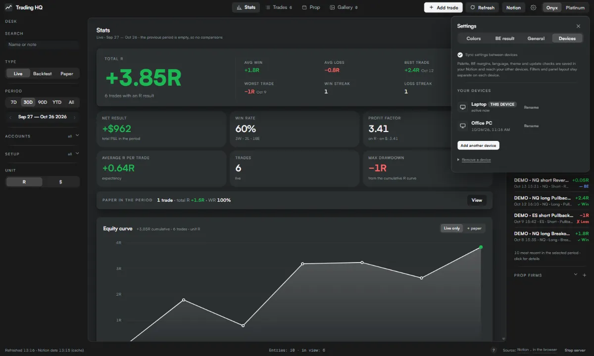
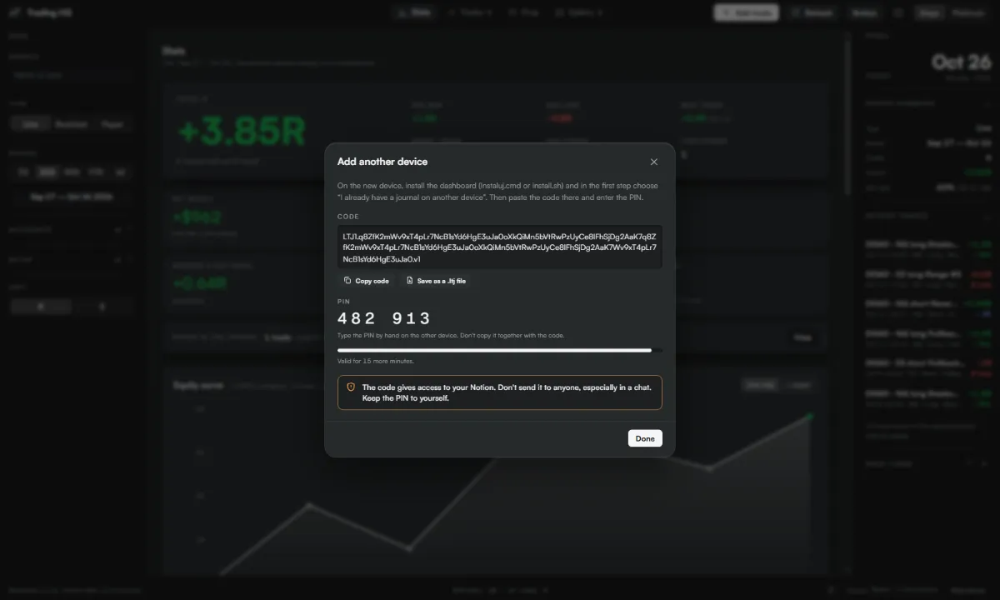
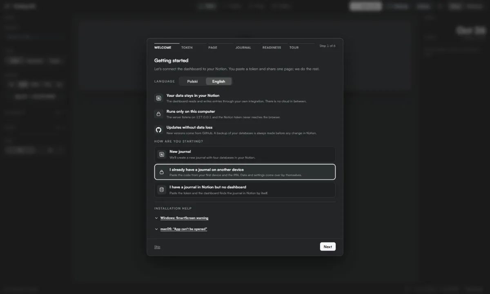
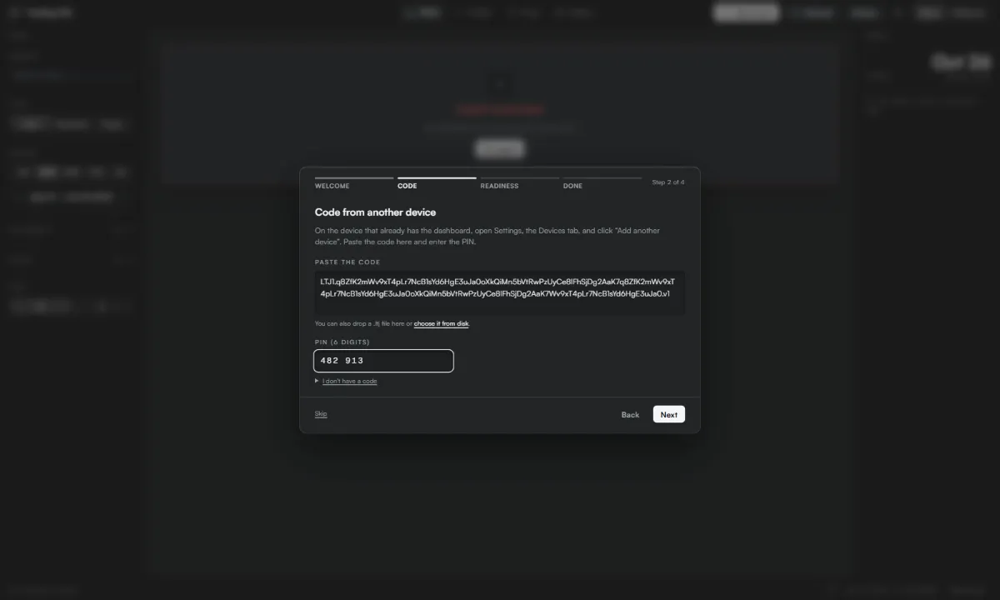
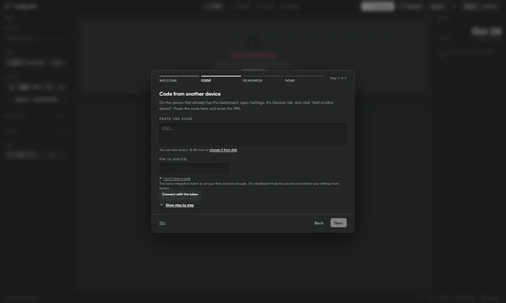
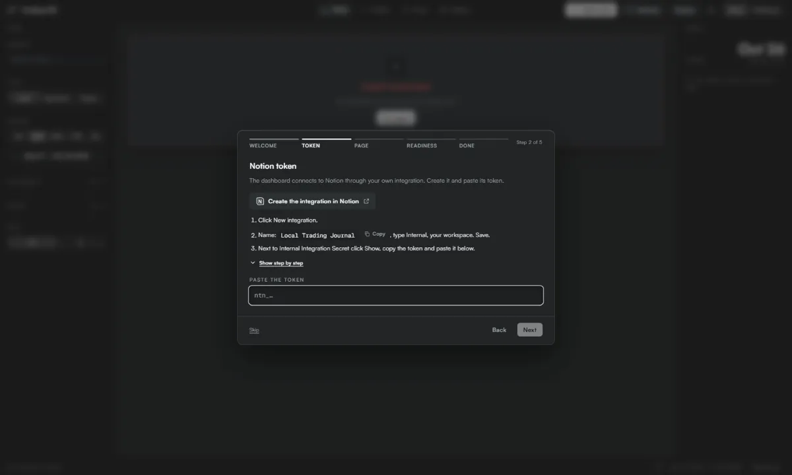

# JustJournal

[Polski](README.md) · **English**

A trading journal in Notion plus a local statistics dashboard that runs only on your computer. Log trades, prop accounts and expenses in Notion or in the dashboard; the dashboard calculates win rate, profit factor, drawdown, R distribution, entry time statistics and much more. No cloud accounts, no npm dependencies, no build step.


| Platinum, Polish UI | Prop tab | Phone |
|---|---|---|
|  |  |  |

Screenshots come from the mock with sample data.

## Contents

- [What you get](#what-you-get)
- [Requirements](#requirements)
- [Installation step by step](#installation-step-by-step)
- [Getting started](#getting-started)
- [Step-by-step guide](#step-by-step-guide)
- [Running](#running)
- [Updating](#updating)
- [Multiple devices](#multiple-devices)
- [Backup and restore](#backup-and-restore)
- [Candlestick charts](#candlestick-charts)
- [Macro news and calendar](#macro-news-and-calendar)
- [Cards and videos](#cards-and-videos)
- [Licenses and market data](#licenses-and-market-data)
- [How numbers are calculated](#how-numbers-are-calculated)
- [FAQ](#faq)
- [Security and network connections](#security-and-network-connections)
- [Prop firm logos](#prop-firm-logos)
- [Project files](#project-files)

## What you get

- **In Notion:** a "Trading Journal" page with four related databases: Trades, Accounts, Journal, Expenses and payouts. They come with properties, options, formulas (account balance, entry net) and views (Live, Backtest, Paper, screenshot gallery, calendars).
- **On your computer:** a dashboard at http://127.0.0.1:4321:
  - KPIs compared with the previous period, equity curve and drawdown chart, P&L calendar, day heatmap;
  - breakdowns: setup, instrument, session, weekday, direction, entry time (each trade at its minute), duration, nth trade of the day, R distribution;
  - Trades (sortable table), Prop (accounts, payouts, ROI, balance) and Gallery tabs;
  - add and edit trades, accounts and finance entries, saved straight to Notion;
  - add screenshots to a trade: in the detail view and in the edit form you pick a file (from the gallery or camera on a phone), drag it in, or paste a screenshot from the clipboard (Ctrl+V after Win+Shift+S). PNG, JPEG, WebP or GIF up to 10 MB (free Notion plan: 5 MB). The screenshot goes to Notion as an image at the end of the trade page (screenshots in the "Screenshot" property stay untouched) and needs the integration's "Insert content" capability; removing screenshots stays in Notion. The dashboard also shows images pasted by hand into a trade page body in Notion (e.g. from a phone), so a screenshot added on one device shows up on the other;
  - candlestick charts for ES, NQ, MES and MNQ trades: a preview in the dashboard's look, an editor with drawings saved to Notion, thumbnails in the trade list, candles from Databento on your own key (see [Candlestick charts](#candlestick-charts));
  - USD macro news and S&P 100 earnings as chart overlays, the "Today" and "Earnings" cards in the left panel and a Calendar tab with search since 2010 (see [Macro news and calendar](#macro-news-and-calendar));
  - share results as an image or a video ("Share" button): a trade card with the price chart and the position drawing, or a day, week, month or year card with the equity curve, in 9:16, 4:5, 1:1 and 16:9 (videos: 9:16, 1:1 and 16:9), result in R, $ or %, chosen data rows, theme background, your own photo or video; download a PNG, an MP4 (or WebM), copy it or share from a phone; set the "JustJournal × nickname" signature in Settings;
  - Onyx and Platinum themes, data palettes (including colour-blind friendly), Polish and English;
  - an update module and "Getting started" (installation check and a guided tour).

## Requirements

- [Node.js](https://nodejs.org) **22 or newer**. The launch scripts check the version and tell you what to do.
- A Notion account (the free plan is enough).
- Optionally [git](https://git-scm.com) if you want to update with `git pull`.
- Windows, macOS or Linux.

## Installation step by step

### 1. Download the app

Pick one:
- **git (recommended):** `git clone https://github.com/Paneksu/local-trading-journal.git`
- **ZIP:** on the [Releases](https://github.com/Paneksu/local-trading-journal/releases) page download "Source code (zip)" of the latest release and unpack it anywhere.

### 2. Run the installer

- Windows: double-click **`Instaluj.cmd`**. Without Node.js the installer offers to install it with `winget` (type "y"). On the first run Windows may show a SmartScreen warning: "More info" → "Run anyway".
- macOS / Linux: in a terminal inside the app folder run `./install.sh` (or `sh install.sh`).

The installer creates a "JustJournal" desktop shortcut, starts the dashboard in the background and opens the "Getting started" wizard in your browser. Then you do three things:

1. **Language** is detected from the browser; change it with one click. It sets the database and property names in Notion.
2. **Token:** the "Create the integration in Notion" button opens the integrations page. Create an Internal integration (copy the name with one click), copy the "Internal Integration Secret" and paste it into the wizard. The wizard checks it right away and stores it locally in `.env`.
3. **Access:** in Notion, on any page (e.g. an empty "Trading" page) choose "•••" → "Connections" → your integration. The wizard notices the page within seconds, no links to paste.

Then a single "Create the journal" button builds the home page, the four databases with relations, formulas and views and (by default) a few entries prefixed "DEMO · " so the charts have something to show. Progress is shown stage by stage; if something interrupts it, "Retry" continues where it stopped, without duplicates. Finally the wizard checks the whole installation and offers a short guided tour.

If the shared page already holds a journal (reinstall or a second computer), the wizard offers "Connect the existing journal" instead of creating a new one.

Every manual step in the wizard has a "Show step by step" link with illustrations (see [Step-by-step guide](#step-by-step-guide)).

Remove the DEMO entries with the button in "Getting started" or with `node setup.mjs --remove-demo` (asks for confirmation and moves only entries starting with "DEMO · " to the Notion trash).

**Terminal install (fallback):** `Instaluj.cmd --cli` or `./install.sh --cli` walks through the same steps in the console (pasting the page link). Unattended, e.g. for scripts: `node setup.mjs --lang en --token ntn_… --parent <page link> --demo --yes`.

### Alternative: duplicate the template

If you prefer clicking in Notion: open [the Notion template (EN)](https://abalone-tendency-4c7.notion.site/Local-Trading-Journal-template-EN-405afccce4f181d394ccf12f1c92abec) and choose "Duplicate". Then:
1. create the integration as in step 2 and add it to the duplicated page ("•••" → "Connections");
2. create a `.env` file in the app folder:
   ```
   NOTION_TOKEN=ntn_…
   DS_TRADES=…
   DS_KONTA=…
   DS_DZIENNIK=…
   DS_FINANSE=…
   NOTION_ROOT_URL=https://www.notion.so/…
   ```
   Copy each database's data source ID in Notion: the database "•••" menu → "Manage data sources" → "Copy data source ID". (`DS_KONTA` is Accounts, `DS_DZIENNIK` is Journal, `DS_FINANSE` is Expenses and payouts.)
3. start the dashboard. Properties are recognised by name (English or Polish) and remembered.

### Views by hand

The installer creates views through the Notion API. If Notion rejects one, the installer lists it at the end and "Getting started" shows it as a warning. Adding it takes three clicks: "+" next to the view names above the database → pick the type (Table, Gallery or Calendar) → name it. For the gallery set "Layout" → "Card preview: Screenshot", for the calendar "Show calendar by: Date", for Live / Backtest / Paper add a filter "Type is …".

## Getting started

On the first run the dashboard opens "Getting started". It is always available from Settings (the gear) and from "?" in the status bar.

- **Readiness:** a checklist: Node, Notion key, page access, the four databases with entry counts, property mapping, views, write permissions, server protection, updates and DEMO entries. Every problem comes with short fix instructions. "Fix everything" applies all safe repairs with one button (missing properties, options and views, re-mapping properties, the Notion shortcut) after showing what will be added. A bad token or missing access takes you to the right wizard step. A quick check runs in the background on every start; if something is wrong, "Needs attention" appears in the status bar. Checks only read; the write check sends a request that Notion rejects at validation, so nothing is created.
- **How the journal works:** a short guided tour of the real interface on sample data kept in browser memory. Nothing reaches Notion in this mode, and your data and filters come back when you leave.


## Step-by-step guide

The wizard shows the same frames under "Show step by step". They are illustrations recreated from the real screens; the layout in Notion and in your system may differ slightly.

<details>
<summary><b>Installing Node.js on Windows</b></summary>

1. Right-click the Start button and choose Terminal.

   

2. Type winget install OpenJS.NodeJS.LTS and press Enter.

   

3. Wait for the success message. If Windows asks for permission, click Yes.

   

4. Without the console: go to nodejs.org/en/download and download the Windows Installer (.msi), LTS version.

   

5. Run the downloaded file and click Next, keeping the default settings. Click Finish at the end.

   

6. Open a new Terminal and type node -v. Version 22 or higher is fine.

   

</details>

<details>
<summary><b>Installing Node.js on macOS</b></summary>

1. Go to nodejs.org/en/download and download the macOS Installer (.pkg), LTS version.

   

2. Open the downloaded .pkg file and click Continue, then Agree at the license step.

   

3. When you see the success message, click Close.

   

4. Using Homebrew? Instead of the installer, type brew install node in Terminal.

   

5. Check the version with node -v. Version 22 or higher is fine.

   

</details>

<details>
<summary><b>First run of Instaluj.cmd (SmartScreen)</b></summary>

1. Open the unpacked app folder and double-click Instaluj.cmd.

   

2. If a blue Windows window appears, click More info.

   

3. Check that the app is Instaluj.cmd and click Run anyway.

   

4. The installer window opens. Type 1 (Polish) or 2 (English) and press Enter.

   

</details>

<details>
<summary><b>Running install.sh on macOS and Linux</b></summary>

1. In Terminal, go to the app folder, make the script executable and run the installer.

   

2. The installer starts in the same window. Type 1 (Polish) or 2 (English) and press Enter.

   

3. Without typing commands: right-click install.sh, choose Open With and then Terminal.

   

4. If macOS warns about an unidentified developer, click Open.

   

5. Newer macOS shows no Open button. Then in System Settings, under Privacy & Security, click Open Anyway.

   

</details>

<details>
<summary><b>Creating a Notion integration</b></summary>

1. Go to notion.so/profile/integrations and click New integration.

   

2. Enter the name JustJournal, pick your workspace and the Internal type, then click Save.

   

3. After saving, click Configure integration settings.

   

4. Under Capabilities keep Read content, Update content and Insert content checked, then click Save.

   

</details>

<details>
<summary><b>Copying the integration secret</b></summary>

1. In the integrations list, click JustJournal (older installs: Local Trading Journal).

   

2. Next to Internal Integration Secret, click Copy. If you do not see it, click Show first.

   

3. In the installer window, right-click or press Ctrl+V to paste the key, then press Enter.

   

</details>

<details>
<summary><b>Sharing a page with the integration</b></summary>

1. Open an empty Notion page for the journal (e.g. Trading) and click ••• in the top right corner.

   

2. In the menu, hover over Connections.

   

3. Type Just and choose JustJournal from the list (older installs: type Local, choose Local Trading Journal).

   

4. Click Confirm. The integration gets access only to this page and its sub-pages.

   

5. Copy the page link: click Share, then Copy link.

   

6. Paste the link into the installer window and press Enter. The installer creates the journal inside that page.

   

</details>

<details>
<summary><b>Changing the Notion token</b></summary>

1. Open Settings (the gear icon), the General tab, and click Change token.

   

2. Confirm. The old token is replaced only once the new one works.

   

3. Paste the new token into the field. The check starts by itself, no extra button.

   

</details>

<details>
<summary><b>Moving to a new device with a code</b></summary>

1. On the device that already has the dashboard, open Settings (the gear icon), the Devices tab, and click Add another device.

   

2. Click Generate code. Copy the code or save it as a .ltj file, and copy the PIN by hand. The code works for 15 minutes and only once.

   

3. Install the dashboard on the new device. In the first step choose I already have a journal on another device and click Next.

   

4. Paste the code (or drop the .ltj file), enter the PIN and click Next. The dashboard connects to your journal and pulls your settings by itself.

   

   _The code gives access to your Notion. Do not send it to anyone, especially over chat. The code and PIN in this picture are made up._

</details>

<details>
<summary><b>Moving with the token, without a code</b></summary>

1. Open notion.so/profile/integrations and click the JustJournal integration (older installs: Local Trading Journal), the same one as on the first device.

   

2. Next to Internal Integration Secret, click Show and then Copy. Do not create a new integration, the same token is enough.

   

3. On the new device choose I already have a journal on another device, open I don't have a code and click Connect with the token.

   

4. Paste the token into the field. The dashboard checks it, finds your journal and pulls your settings from Notion by itself.

   

</details>

## Running

- **Windows:** `Dashboard.vbs` (no console window; logs in `dashboard.log`) or `Dashboard.cmd` (with a console window, for troubleshooting). Desktop shortcut with an icon: `powershell -ExecutionPolicy Bypass -File narzedzia\utworz-skrot.ps1`.
- **macOS / Linux:** `./start.sh` (in the background, logs in `dashboard.log`) or `./start.sh --foreground`.
- Address: http://127.0.0.1:4321. If the dashboard is already running, the scripts just open the browser.
- Stop: the "Stop server" button in the bottom right corner.

## Updating

Every update does, in order: **backup** of the four databases to `backups/<date>/` → **download** of the new version → Notion schema **migrations** (add only) → **restart**. It never overwrites `.env`, `config.local.json`, `backups/` or `public/img/firmy/custom/`, and browser settings (palette, margins, filters, theme) stay.

Two ways:
1. **From the dashboard:** when a new version exists, "New version X" appears in the status bar. The update window shows the release notes, the Notion plan (what will be added; nothing is removed) and the progress of each stage. After the restart the page reloads by itself. On error you get a description, the backup path and a command for the terminal.
2. **By hand:** `Aktualizuj.cmd` (Windows) or `./update.sh`. Preview without any changes: `node update.mjs --dry-run`.

Where the new version comes from:
- **git** install: `git pull --ff-only`. If the app folder has local code changes, the update refuses and explains what to do;
- **ZIP** install: the latest release archive from `codeload.github.com`, applied only when the file checksum published in the release matches.

Migrations only add new properties, options and views. They never delete, change types, rename properties that hold data or touch entry values. Rules: [CONTRIBUTING.md](CONTRIBUTING.md).

Turn update checks off in Settings → General.

## Multiple devices

Your data lives in Notion, so every device sees the same trades, accounts and entries. Only the configuration moves to a new device.

**With a transfer code (recommended, three moves):**
1. On the first device: Settings → "Add another device". The dashboard shows a transfer code and, separately, a 6-digit PIN. The code is valid for 15 minutes. Copy it or save it as a `.ltj` file.
2. On the new device download the app and run `Instaluj.cmd` or `./install.sh`. In the wizard choose "I already have a journal on another device".
3. Paste the code (or drop the `.ltj` file), type the PIN and click "Next". The token, home page, property mapping, custom logos and settings are all in place.

**Without a code:** choose "I have a journal in Notion but no dashboard", paste the same token (Notion → integration → "Show") and share the journal page; the wizard finds it. Settings still come from Notion.

**Settings sync:** palette (separately for Onyx and Platinum), BE margins, language, theme and update checks are stored in a collapsed "Dashboard settings (do not edit)" block at the end of the Notion home page, without the token. The dashboard writes it 2 s after a change and reads it on start and on auto-refresh; on conflict the latest change wins. Filters (type, period, accounts, setup) stay per device, as a local convenience. Switch: Settings → "Sync settings between devices". Existing installs get the block when updating to 1.1.0 (the migration appends it to the end of the page and leaves everything else alone).

**Device list** (Settings): name (the computer name by default), last seen, rename. Removing a device: the token is shared by all devices, so generate a new token in Notion (integration → refresh the secret) and paste it on the devices that stay ("Change token"). The others lose access.

**Security and limits:**
- The code carries the token to your Notion. It is encrypted (AES-256-GCM, key from the PIN via PBKDF2-SHA256, 210,000 iterations, random salt), but a 6-digit PIN only protects it briefly. That is why the code expires after 15 minutes, works once and is locked after 5 wrong PINs. Do not send the code over chat or e-mail: carry it yourself, e.g. as a `.ltj` file on a USB stick.
- The PIN is generated cryptographically and shown separately. Neither the code nor the PIN goes to logs or browser storage.
- Export and import have the same protection as writes: 127.0.0.1 only, the dashboard Host and Origin, the `X-THQ` header.
- Custom logos from `public/img/firmy/custom/` are included when small (up to 60 KB each, 150 KB in total); larger ones are listed as skipped.

## Backup and restore

- A backup is made on every update in `backups/<date>/` (JSON: schema and all entries with their values). The folder is in `.gitignore`.
- Restore: `node restore.mjs` shows a **preview only** (what would be restored from the latest backup). `node restore.mjs --apply` writes after you type "YES". Pick another backup by path: `node restore.mjs backups/2026-10-26T10-00-00Z`.
- Restore puts field values back, takes entries out of the trash and recreates missing ones. It deletes nothing: entries added after the backup stay. Files uploaded to Notion (screenshots) are not in the backup because their URLs expire after an hour.
- Chart drawings live in the "Drawings" property in Notion, so backup and restore cover them unchanged. Downloaded candles (`chart-data/`) are not in the backup.

## Candlestick charts

Since version 1.3.0 every ES, NQ, MES or MNQ trade has a candlestick chart with the trade's levels. MES uses ES candles and MNQ uses NQ candles. Other instruments (e.g. EURUSD, XAUUSD, NAS100) show "No data source for this instrument" and download nothing.

**Preview and editing.** In the trade details the "Chart | Screenshots" switch opens the preview: a chart in the dashboard's look (Onyx or Platinum theme, palette colours) with entry, exit, SL, TP and BE, panning and zooming. Timeframes: 15s, 1m, 5m, 15m, 1h, 4h, 1D, 1W, 1M and a "Custom" field (e.g. `3m`, `45s`, `2h`). The "Edit" button switches to the TradingView Lightweight Charts™ editor with drawings: horizontal line, trend line, rectangle, FVG, Fibonacci, text and long/short position, undo with Ctrl+Z. After unlocking it in the editor you can also move the trade's position drawing (SL, TP, BE, exit and time), and the changes go to the trade's properties in Notion. The R result and P&L stay as you typed them. "Done" returns to the preview in the same frame and timeframe. The trade list and the day view in the calendar show chart thumbnails (candles and levels, no drawings).

**Drawings in Notion.** Drawings are saved 2 s after a change to the trade's "Drawings" text property (JSON, up to 190,000 characters per trade). The dashboard adds it with migration 003 during an update, together with the price properties; migrations 004 and 005 add the "BE" and "Contract" properties. With two devices the last save wins. Without internet the drawings wait in a local cache and are sent the next time the chart opens. In a Notion table the "Drawings" column shows raw JSON. Migrations cannot change existing views, so hide it by hand in every view where it gets in the way: above the table "•••" → "Properties" → the eye icon next to "Drawings". Hiding deletes nothing, and the dashboard still reads and writes the property.

**Contracts and rolls.** Candles come from Databento's continuous symbol `ES.v.0` / `NQ.v.0` (the contract with the highest volume), with the contracts' real prices, not adjusted at rolls. A vertical line marks a contract change. In the "Contract" property (e.g. `ESZ6`) you can set the trade's contract; an empty property means the contract by date. The B-ADJ switch (like in TradingView, on by default) shifts the other contracts' prices by the roll gaps relative to the trade's contract, so entry, SL and TP land on the exact tick. Session hours, PDH/PDL and the axis time zone are in Settings → Charts.

**Databento key.** You download candles from [Databento](https://databento.com) (the CME Globex MDP 3.0 dataset, `GLBX.MDP3`) with your own key, without a subscription, paying for usage. Create an account, open "API keys" in the Databento portal, click "Create a new key" and copy the key. In the dashboard: Settings → Charts → "Databento data" → paste the key → "Save and check". The key is checked with a free request and saved only in `.env` on this computer (`DATABENTO_API_KEY`). It never reaches the browser, the logs, Notion or settings sync. Without a key the charts show the candles that are already on disk.

**What downloads by itself and what on a click.**
- For every trade a background queue adds a 1s candle window from 30 min before entry to 30 min after exit (usually about 0.02 USD per trade).
- Daily NQ 1s window 9:30–11:00 New York time: the "Download NQ 1s 9:30–11:00 NY every day" switch in Settings → Charts (on by default, this computer only). The queue downloads the window every Monday to Friday once Databento makes it available (about 0.02 USD per day) and catches up at most the last 7 days during which the dashboard was off. Older days only with the import tool (below).
- The minute candles of the trade's session and longer history are downloaded with the "Check cost" button next to the chart: you first see the quote from a free Databento request, then you confirm.
- Windows and days already on disk are never downloaded again.

**Costs and app limits.** Before every download the server asks Databento for the cost (free) and asks again right before downloading. Hard limits in the app:
- at most **1 USD per download**;
- at most **3 USD per UTC day** (counter of today's spending);
- **credit counter:** Databento gives new accounts starting credit (125 USD valid for 6 months according to Databento's pricing page in October 2026). The dashboard cannot see the Databento balance, so it counts spending itself and rejects a download when the quote exceeds the remaining credit or the credit has expired, so your card is not charged. Enter your starting amount and expiry date in `config.local.json` (`chartCredit: { startUsd, spentUsd, expires }`).

Settings → Charts shows the limits, today's spending, the credit and the size of downloaded candles as view-only. You change them in `config.local.json` (`chartCostLimitUsd`, `chartDailyLimitUsd`, `chartCredit`). Estimate from Databento quotes in October 2026 (prices may change; the real cost is always the quote before a download): the full 1m history of ES and NQ since 2010 about 41 USD, NQ 1s windows 9:30–11:00 since 2020 about 34 USD.

**Data embargo.** Without a subscription Databento releases historical data with a delay of about 8 hours. Candles from a session in progress therefore appear later: the chart shows "Candles available until: …", and trades from such a session show "Candles from this session will be available around …". The queue waits by itself for windows that are not there yet.

**Timeframes below one minute.** Real one-second candles exist only where a downloaded 1s window lies (trades and the daily NQ window). Outside the windows, timeframes below a minute (e.g. 30s, 15s, 5s, 1s) still work across the whole chart: each 1m candle is split into parts along the path open → extreme → other extreme → close and drawn slightly dimmed, and the tooltip says "from 1m". A minute even partly covered by a 1s window is real as a whole. Share cards use real seconds only: when the trade frame is not fully covered by a 1s window, the card uses 1m candles.

**History import with a budget.** The tools in `narzedzia/` talk to the running dashboard (the key and counters stay in the server) and by default only quote, costing nothing:
- `node narzedzia/import-okien-1s.mjs`: quote for NQ 1s windows 9:30–11:00 NY since 2020-01-02 (or `--od=`/`--do=`, from/to). Downloading starts only with `--potwierdzam-usd=AMOUNT` (the amount from the quote), with a hard budget `--budzet-usd` (36 USD by default and at most) counted in `chart-data/import-1s-nq.json`. The server downloads in batches of up to 1 USD and checks the budget before each batch; the import counts towards the 3 USD daily limit, so on an import day regular downloads may wait until UTC midnight. Resume an interrupted import with the same command.
- `node narzedzia/import-historii-1m.mjs`: quote for the 1m history of ES and NQ (`--instrument=ES|NQ|ALL`). Downloading needs `--potwierdzam-usd=AMOUNT` and an explicit raise of the app limits for this import only (`--limity-do-usd=AMOUNT`); the credit guard still applies.

**Candle store.** Candles live in the `chart-data/` folder next to `config.local.json` (binary format, 24 bytes per candle, separate 1m and 1s layers plus contract layers). The folder is in `.gitignore`, updates do not touch it, and the update backup does not include it. Estimate: one 1m session of one symbol is about 35 KB, a 1s window 9:30–11:00 about 130 KB, and the full 1m history of ES and NQ since 2010 with NQ 1s windows since 2020 is about 0.5 GB. The size is shown in Settings → Charts. You delete candles by hand on disk; downloading them again costs money.

**Settings → Charts.** The tab has these groups:
- "Chart look": candles or close line (separately for thumbnails), palette colours or your own per theme with a contrast check, grid, which trade levels to show;
- "Overlays": Asia, London and NY session background (hours in New York time) with high/low lines until the sweep, and PDH/PDL;
- "Share cards": price chart on cards (on / off), style, position drawing, equity curve on period cards, and starting values for videos (format, length, black and white, background dimming);
- "Time and prices": axis time zone and B-ADJ;
- "Databento data": the key, limits and credit as view-only, the size of `chart-data/`, the daily NQ 1s window switch;
- "Licenses": TradingView attribution, the drawing package, the note on CME data and background videos.

Look, overlays and cards sync through Notion like the other settings. The key, limits, credit and the 1s window switch stay on this computer only.

## Macro news and calendar

Since version 1.4.0 the journal shows USD macro news and earnings of S&P 100 companies.

**Where you see them.**
- The "News" chart overlay (preview and editor, off by default): a dashed line and a marker at the release time, in the colour of the highest impact (red, orange, yellow, grey for Bank Holiday). Several events in the same minute share one marker with a count; the tooltip opens with a mouse, the keyboard or touch. All-day events (Bank Holiday, OPEX) are a day label without a line.
- The "Earnings" overlay (separate, off by default): a diamond at the announcement, before the open (before 9:30) or after the close (after 16:00) New York time.
- The "Today" and "Earnings" cards in the left panel: today only.
- The "Calendar" tab: day, week and month views, filters for impact, event type and company class, and search across news and earnings in the whole history since 2010.

You switch impacts, classes and cards in Settings → Charts → "News" and "Earnings". Times follow the chart time zone.

**What history has.** Macro data (CPI, NFP, PPI, Retail Sales, GDP, PCE, ISM, JOLTS, Unemployment Claims, UoM and more), FOMC decisions, press conferences and minutes, speeches and testimonies of the Fed Chair, Fed announcements outside meetings, TIC, market holidays (Bank Holiday) and OPEX days (3rd Friday of the month, quarterly in March, June, September and December). Impacts depend on the date, because ForexFactory changed them over the years. We checked the history against the ForexFactory calendar on a sample of 28 months from 2010–2026: Bank Holiday 21 of 21 days, red events of the types covered by history 98.5% with the time to the minute, all red events (including speeches) 85.7% ([details, in Polish](docs/plany/newsy-zgodnosc.md)).

**What history does not have.** Speeches by the President, the Treasury Secretary and FOMC members other than the Chair (the Chair's speech times are uncertain), and releases without a fixed schedule: Existing and Pending Home Sales, flash S&P Global PMI and the Treasury currency report. These appear only from the current week's feed, so from the day you install. Releases that came out a few minutes early or late keep the scheduled time in history.

**Earnings in 4 classes.** Class 1 (red): NVDA, MSFT, AAPL, AMZN, GOOGL, META, TSLA, AVGO. Class 2 (orange): big banks and sector leaders, e.g. JPM, GS, NFLX, LLY, WMT, V. Class 3 (yellow): the rest of the top fifty. Class 4 (grey): the remaining S&P 100. In Settings → Charts → "Earnings" you can move a company to another class or add your own.

**Sources.**
- **FRED** (Federal Reserve Bank of St. Louis): release dates for 2010–2026 ship with the release. Your own key is optional and refreshes future dates once a day.
- **Fed:** the FOMC calendar in the app plus JSON archives from `www.federalreserve.gov` (speeches, testimonies and announcements), refreshed once a day.
- **ForexFactory:** only the public export feed for the current week (`nfs.faireconomy.media`), fetched at most once an hour. It brings up-to-date times and the week's minor news. Feed data stays local in `chart-data/news/`, is for your own use and never goes onto cards or videos.
- **SEC EDGAR:** earnings history since 2010 ships with the release (a tool in `narzedzia/` generates it; the dashboard does not connect to the SEC).
- **Finnhub:** future earnings dates, only with your key. Without a key history works and new dates do not appear.

**FRED and Finnhub keys (optional).**
1. FRED: create a free account at [fred.stlouisfed.org](https://fred.stlouisfed.org), open "API Keys" in "My Account" and request a key (32 characters).
2. Finnhub: create a free account at [finnhub.io](https://finnhub.io) and copy the API key from the dashboard.
3. In JustJournal: Settings → Charts → "News" → "FRED key" field → paste → "Save"; the same for "Finnhub key" in the "Earnings" group. The refresh starts in the background and its state shows in the same group.

Keys are stored only in `.env` on this computer (`FRED_API_KEY`, `FINNHUB_API_KEY`). They never reach the browser, the logs, Notion or settings sync, so you enter them on each computer separately.

**Multiple devices.** News and earnings settings sync through Notion like the rest of the chart settings. A device on 1.3.0 does not know the new fields and resets them to defaults when it saves settings, so update all devices to 1.4.0.

**Licenses.** This product uses the FRED® API but is not endorsed or certified by the Federal Reserve Bank of St. Louis. JustJournal is not affiliated with ForexFactory (Fair Economy), Finnhub or the SEC.

## Cards and videos

The "Share" window has a large preview and groups: File (image or video, format) → Card (trade, day, week, month, year) → Chart → Big number (R, $ or %) → Data → Background, with the rarer options under "More options".

- **The price chart on a trade card** comes from candles already on disk (the card downloads nothing). Style: candles or a light line. Position drawing: "Position" (profit and loss zones to TP and SL, like in TradingView) or "Entry and exit" (markers only). Period cards show the equity curve.
- **Data rows** under the big number are picked with pills, at most 4 (e.g. entry and exit price, the other unit, SL, TP, duration; for a period: trades, win rate, best trade, profit factor). The 6 most common are shown, the rest after "Show all".
- **Formats:** a PNG image in 9:16, 4:5, 1:1 and 16:9, a video in 9:16, 1:1 and 16:9.
- **Videos** are recorded in the browser in real time (keep the tab in front), as MP4 in Chrome, Edge and Safari, and as WebM in browsers without MP4. Videos have no sound. Length, quality, black and white and background dimming are under "More options".
- **Background:** theme, your own photo or (for videos) your own video. **The background video and photo stay local:** you pick them from disk for each recording, they are processed only in the browser and never reach the server, Notion or settings sync. **Rights to the video and the music are yours to clear:** use only footage you have the rights to (picture and music).
- Before publishing a card or video with a price chart, read [Licenses and market data](#licenses-and-market-data). Turn the chart on cards off in Settings → Charts → "Share cards".

## Licenses and market data

**TradingView Lightweight Charts™.** The chart editor uses the TradingView Lightweight Charts™ 5.2.1 library (Apache-2.0 license). Attribution: "TradingView Lightweight Charts™, Copyright (c) 2025 TradingView, Inc.", https://www.tradingview.com/. The licence and the NOTICE file are in `public/vendor/lightweight-charts/`, and the attribution with a link is under the chart and in Settings → Charts → "Licenses". Drawing tools: `lightweight-charts-drawing` 0.6.2 (MIT, `public/vendor/lightweight-charts-drawing/LICENSE`). Both libraries are included unchanged, with checksums in `public/vendor/VENDOR.md`.

**CME data via Databento.** The candles are CME Group market data downloaded with your key from Databento, under the terms of your Databento account and the CME license that Databento passes on to its users. This is not legal advice, only a summary of the sources we read:
- Databento says that redistribution rights depend on the dataset and that it passes through the licensing restrictions of the original publisher, here CME ([Databento pricing](https://databento.com/pricing)).
- CME's guidelines on historical data say that making historical information available on a public website, e.g. in chart or table form, requires a CME distribution license (a sentence from the CME document "Data Licensing Policy Guidelines: Historical Information Distribution", known to us from a search engine index).
- The standard CME agreement for data users at distributors (Subscriber Addendum) allows displaying the data for your own business activities and forbids redistributing it outside the subscriber group without CME's permission.

What this means for you:
- **Historical data is for your own use in the journal only, not for redistribution.** Do not share the `chart-data/` folder or candle files with others. The repository contains no candles and no key; test data is synthetic.
- **You publish cards and videos with a price chart at your own risk.** The chart on cards is on by default because the author uses it at his own risk, but every user decides alone whether their data license allows it. If you are not sure, turn the chart on cards off (Settings → Charts) or ask Databento or CME. The equity curve, the result and the prices you typed are your data, not CME data.
- Drawings saved in Notion are coordinates and styles, not candles.

## How numbers are calculated

- **Win / Loss / BE:** "Manual result" first, then R with the BE margin (default ±0.1R), and if R is empty, P&L $ with its own margin (default $0). Set the margins in Settings.
- Win rate = wins / (wins + losses); BE is not in the denominator.
- Profit factor = gross profit / gross loss (in R, and for Live also in $).
- Max drawdown from the cumulative R curve, from the highest peak.
- Comparison with the previous period: the same length right before the selected one.
- Types: Live, Backtest, Paper (good setups you did not take; hypothetical R). Live never includes Paper; the "+ paper" switch adds them to breakdowns and the curve.
- Entries without R, P&L and result, and those with direction NO TRADE, are not counted as trades.
- Entry time is the "Date" property with a time; duration is the difference between "Date" and "Exit". Day and hour use the browser's local time.
- Totals and statistics are calculated from raw properties, not from Notion formulas.

## FAQ

**Can I rename a property or database in Notion?** Yes. The dashboard finds properties by IDs stored in `config.local.json`, so renaming breaks nothing. Do not change a property's type (e.g. number to text).

**Can I add my own properties and options?** Yes. The dashboard does not use them and updates leave them alone. New options (setup, instrument, session, firm) show up in the forms right away.

**How do I delete a trade?** In Notion. The dashboard deliberately does not delete, because that cannot be undone safely. The edit form has an "Open in Notion" link.

**My Notion key stopped working (401).** Generate a new integration secret, put it in `.env` (`NOTION_TOKEN=…`) and restart the dashboard. "Getting started" shows whether it works.

**I use several computers.** Install the app on each and copy `.env` and `config.local.json`. The data lives in Notion, so you see the same everywhere.

**Why is there no "Connect with Notion" button that skips copying a token?** Notion OAuth requires an app secret (client secret). Such a secret cannot be kept safely in a public repository or in an app installed locally: anyone could read it. Doing it safely would need a separate relay server, so for now the internal integration token stays. It is a possible future option.

**How do I change the token?** Settings → General → "Change token". The wizard checks the new token before saving it.

**Port 4321 is taken.** Use another one: `PORT=4400 node server.mjs` (Windows: `set PORT=4400` in `Dashboard.cmd`).

## Security and network connections

- **The Notion key stays local** in `.env`. It never reaches the browser, the logs or the repository (`.env` is in `.gitignore`).
- **The server listens on 127.0.0.1 only**, so other devices on your network cannot reach it.
- **Writes are CSRF-protected:** every write, update and stop request needs the dashboard's Host and Origin, a custom `X-THQ` header and `Content-Type: application/json`. A foreign page open in your browser cannot write anything silently. The server validates all data itself.
- **Connections:** the server talks to the Notion API, to the public GitHub API once a day (new version check, none of your data is sent; switch it off in Settings) and, since 1.3.0, to `hist.databento.com` (see below). An update downloads the archive from `codeload.github.com`. In addition the browser loads fonts from Fontshare and Google Fonts (without internet it falls back to system fonts), and a TradingView link preview loads the image from TradingView.
- **Databento (`hist.databento.com`, since 1.3.0):** the only new connection. It is used only after you save a Databento key: key check, free quotes (`metadata.get_cost`), the available data range (`metadata.get_dataset_range`, cached for 15 minutes), contract symbol mapping and candle downloads (`timeseries.get_range`). Only the symbol (`ES.v.0`, `NQ.v.0` or a contract), the schema and the time range are sent, never data from your journal. The service address is fixed: the server refuses anything other than `hist.databento.com`. The key goes only in the authentication header of this connection; it never reaches the browser, the logs, Notion or API responses. Without a key the dashboard does not connect to Databento at all.
- **News and earnings (since 1.4.0):** the only new connections are `api.stlouisfed.org` (FRED, only with a saved key), `nfs.faireconomy.media` (the ForexFactory feed for the current week, at most once an hour), `www.federalreserve.gov` (archives of Fed speeches and announcements, once a day) and `finnhub.io` (only with a saved key). Only date ranges and company symbols are sent, never data from your journal. `home.treasury.gov` and the SEC are used only by the tools in `narzedzia/` that generate the release files; the dashboard does not connect to them. The FRED and Finnhub keys stay in `.env`, like the Databento key.
- **Reads protected from other sites:** `GET /api/*` requests with a `Sec-Fetch-Site` header other than `same-origin` or `none` are rejected, so a foreign page cannot read your data or candles.

## Prop firm logos

Logos in `public/img/firmy/` are trademarks of their owners and are used only to identify the firms. They are not covered by the MIT license. Other firms get a monogram.

| File | Firm | Source (downloaded 2026-10-26, resized to 96×96 WebP) |
|---|---|---|
| `lucid.webp` | Lucid Trading | https://lucidtrading.com/wp-content/uploads/2025/09/luciddarkmode-2-4.png.webp |
| `alpha.webp` | Alpha Futures | https://alpha-futures.com/images/webclip-192.png |
| `apex.webp` | Apex Trader Funding | https://apextraderfunding.com/app/uploads/cropped-APEX_FAV-192x192.png |

The `public/img/firmy/custom/` folder is yours: updates never touch it.

## Project files

| Path | What it is |
|---|---|
| `server.mjs` | local server: Notion read and write, write protection, updates, readiness check |
| `setup.mjs`, `update.mjs`, `restore.mjs` | install, update, restore |
| `Instaluj.cmd`, `Aktualizuj.cmd`, `Dashboard.vbs`, `Dashboard.cmd` | Windows launchers |
| `install.sh`, `update.sh`, `start.sh` | macOS / Linux launchers |
| `schema/notion-schema.json` | single source of truth for the Notion page, databases, properties, formulas and views |
| `migrations/` | schema migrations (add only) |
| `lib/` | Notion client, property roles, read and write, backups, migrations, updater |
| `public/` | the interface (HTML, CSS, JS modules, `i18n/` dictionaries) |
| `testy/` | Notion API mock and tests: `node testy/run.mjs` |
| `narzedzia/` | `suma-wydania.mjs` (release checksum), `schemat.mjs` (database property dump), `utworz-skrot.ps1`, `import-okien-1s.mjs` and `import-historii-1m.mjs` (candle import with a budget) |
| `public/vendor/` | TradingView Lightweight Charts™ and `lightweight-charts-drawing`, unchanged, with licenses and checksums (`VENDOR.md`) |
| `chart-data/` | downloaded candles and the drawings cache (created on the first download, outside the repository) |

### Tests

`node testy/run.mjs` runs every test against the Notion mock (`testy/atrapa-notion.mjs`) and a fake release server: PL and EN install, existing install, backup and restore, ZIP and git update, update module with restart, readiness and schema repair, translations, the chart module against a Databento mock (`testy/atrapa-databento.mjs`). No test talks to the real Notion, GitHub or Databento. Browser tests (`testy/wykresy-e2e-*.mjs`, `testy/udostepnij-e2e.mjs`, `testy/zrzuty-e2e.mjs`) run separately with Playwright (`PW_CORE`); instructions are in the header of each file. The dashboard on the mock alone: `node testy/start-test.mjs` (http://127.0.0.1:4331).

## License

[MIT](LICENSE) © Paneksu. Prop firm logos: see above.
