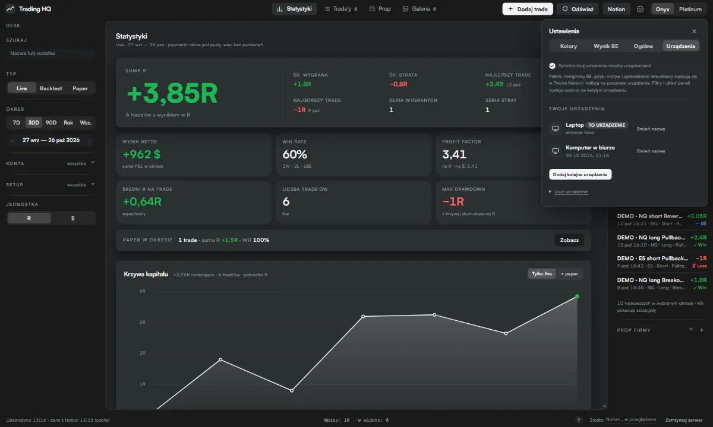
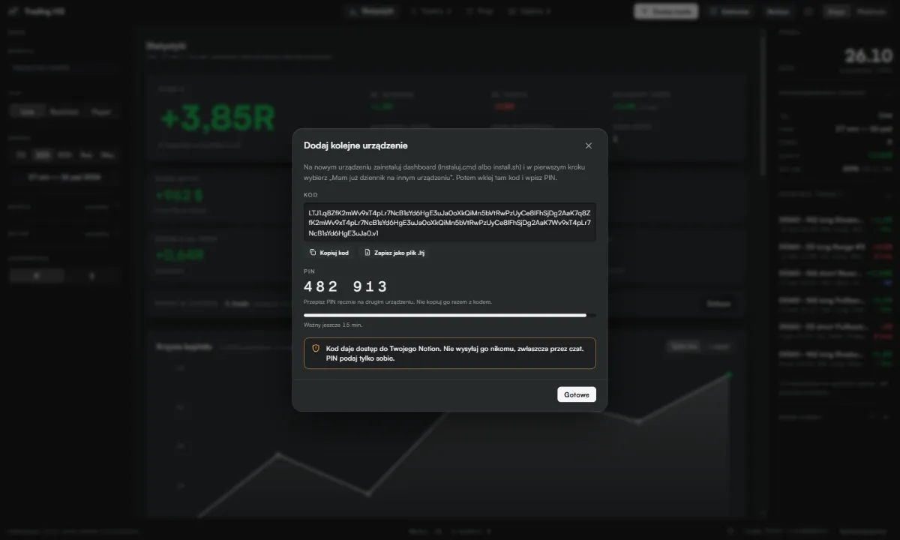
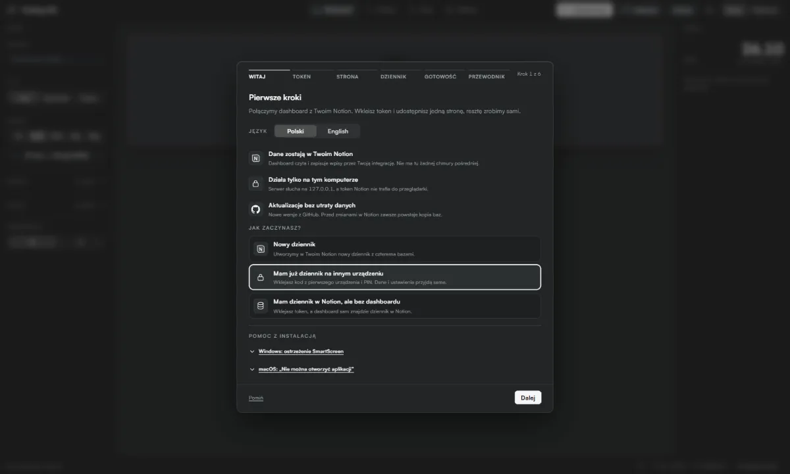
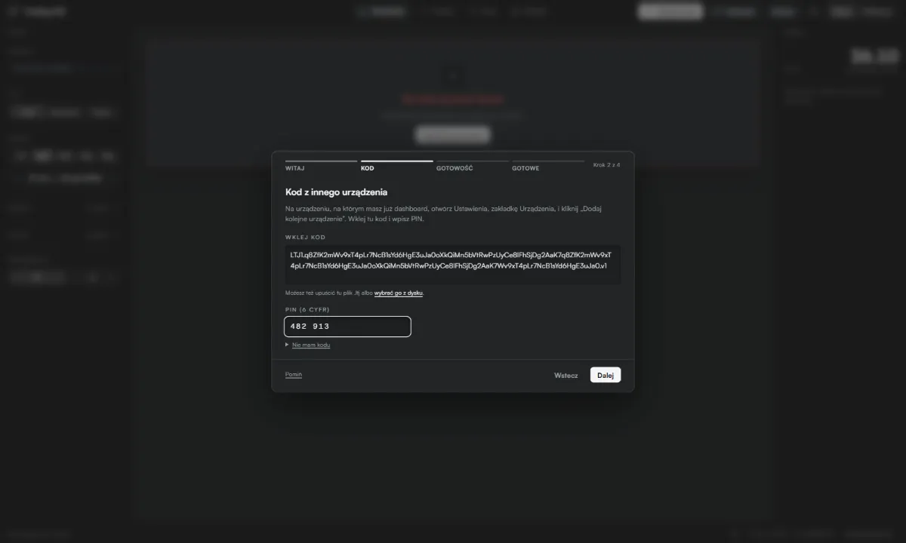
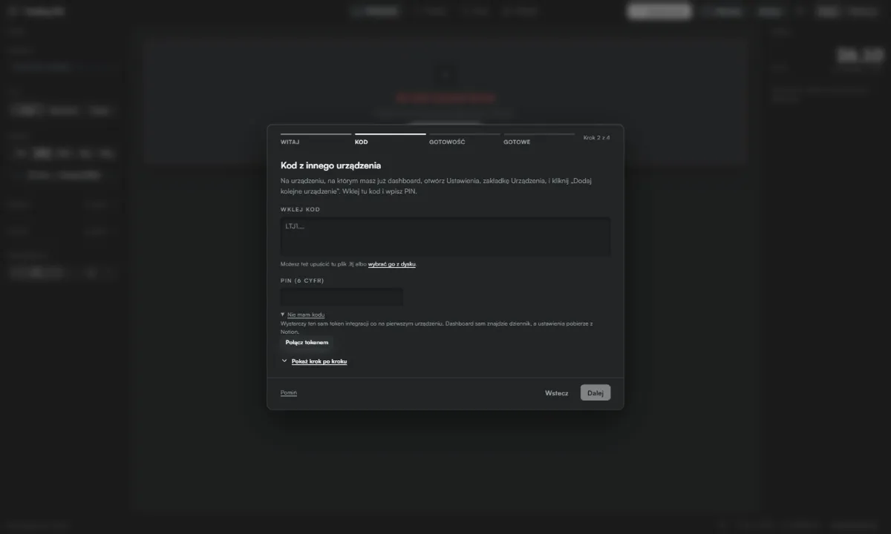
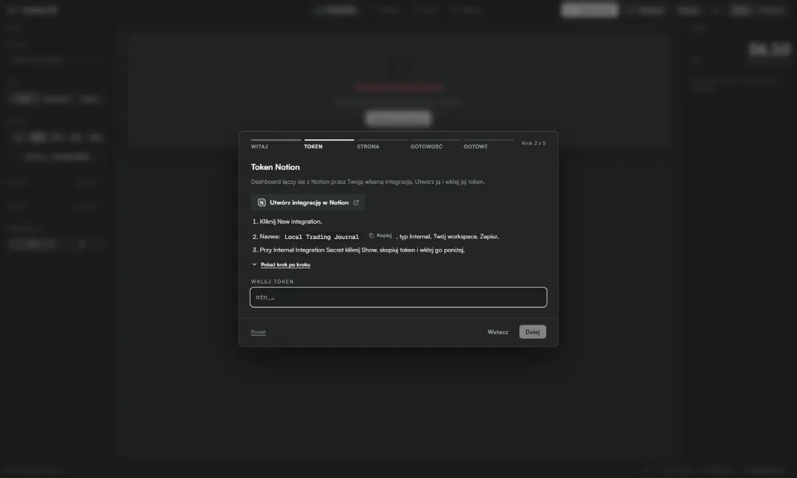

# JustJournal

**Polski** · [English](README.en.md)

Dziennik tradingowy w Notion i lokalny dashboard statystyk, który działa tylko na Twoim komputerze. Trade'y, konta prop i wydatki wpisujesz w Notion albo w dashboardzie, a dashboard liczy win rate, profit factor, drawdown, rozkład R, statystyki godzin wejścia i wiele więcej. Bez kont w chmurze, bez zależności npm i bez kroku build.


| Platinum, po polsku | Zakładka Prop | Telefon |
|---|---|---|
|  |  |  |

Zrzuty pochodzą z atrapy z przykładowymi danymi.

## Spis treści

- [Co dostajesz](#co-dostajesz)
- [Wymagania](#wymagania)
- [Instalacja krok po kroku](#instalacja-krok-po-kroku)
- [Pierwsze kroki](#pierwsze-kroki)
- [Poradnik krok po kroku](#poradnik-krok-po-kroku)
- [Uruchamianie](#uruchamianie)
- [Aktualizacja](#aktualizacja)
- [Wiele urządzeń](#wiele-urządzeń)
- [Kopia i przywracanie](#kopia-i-przywracanie)
- [Wykresy świecowe](#wykresy-świecowe)
- [Karty i filmy](#karty-i-filmy)
- [Licencje i dane rynkowe](#licencje-i-dane-rynkowe)
- [Zasady liczenia](#zasady-liczenia)
- [FAQ](#faq)
- [Bezpieczeństwo i połączenia sieciowe](#bezpieczeństwo-i-połączenia-sieciowe)
- [Logo firm prop](#logo-firm-prop)
- [Pliki projektu](#pliki-projektu)

## Co dostajesz

- **W Notion:** stronę „Dziennik tradingowy” z czterema bazami połączonymi relacjami: Trade'y, Konta, Dziennik, Wydatki i payouty. Mają gotowe pola, opcje, formuły (saldo konta, bilans wpisów) i widoki (Live, Backtest, Paper, galeria zrzutów, kalendarze).
- **Na komputerze:** dashboard pod adresem http://127.0.0.1:4321:
  - KPI z porównaniem do poprzedniego okresu, krzywa kapitału i wykres spadków, kalendarz P&L, heatmapa dni;
  - rozbicia: setup, instrument, sesja, dzień tygodnia, kierunek, godzina wejścia (każdy trade w swojej minucie), czas trwania, kolejny trade w dniu, rozkład R;
  - zakładki Trade'y (tabela z sortowaniem), Prop (konta, payouty, ROI, bilans) i Galeria zrzutów;
  - dodawanie i edycja trade'ów, kont i wpisów finansowych, z zapisem prosto do Notion;
  - dodawanie zrzutów ekranu do trade'a: w podglądzie i w formularzu edycji wybierasz plik (na telefonie z galerii lub aparatu), przeciągasz go albo wklejasz zrzut ze schowka (Ctrl+V po Win+Shift+S). PNG, JPEG, WebP lub GIF do 10 MB (darmowy Notion: 5 MB). Zrzut trafia do Notion jako obraz na końcu strony trade'a (zrzuty z pola „Zrzut” zostają nietknięte), wymaga uprawnienia integracji „Insert content”; usuwanie zrzutów zostaje w Notion. Dashboard pokazuje przy trade'ach także obrazy wklejone ręcznie w treść strony trade'a w Notion (np. z telefonu), więc zrzut dodany na jednym urządzeniu widać na drugim;
  - wykresy świecowe przy trade'ach ES, NQ, MES i MNQ: podgląd w wyglądzie dashboardu, edycja z rysunkami zapisywanymi w Notion, miniatury na liście trade'ów, świece z Databento na Twoim kluczu (patrz [Wykresy świecowe](#wykresy-świecowe));
  - udostępnianie wyników jako obraz albo film (przycisk „Udostępnij”): karta trade'a z wykresem ceny i rysunkiem pozycji albo karta dnia, tygodnia, miesiąca lub roku z krzywą kapitału, w formatach 9:16, 4:5, 1:1 i 16:9 (film: 9:16, 1:1 i 16:9), wynik w R, $ lub %, wybrane wiersze danych, tło z motywu, własne zdjęcie albo film; pobierasz PNG, MP4 (albo WebM), kopiujesz albo udostępniasz z telefonu; podpis „JustJournal × nick” ustawiasz w Ustawieniach;
  - motywy Onyx i Platinum, palety danych (także dla daltonistów), język polski i angielski;
  - moduł aktualizacji i „Pierwsze kroki” (sprawdzenie instalacji i przewodnik).

## Wymagania

- [Node.js](https://nodejs.org) w wersji **22 lub nowszej**. Skrypty startowe sprawdzają wersję i mówią, co zrobić.
- Konto Notion (wystarczy darmowe).
- Opcjonalnie [git](https://git-scm.com), jeśli chcesz aktualizować przez `git pull`.
- Windows, macOS albo Linux.

## Instalacja krok po kroku

### 1. Pobierz aplikację

Wybierz jedną drogę:
- **git (zalecane):** `git clone https://github.com/Paneksu/local-trading-journal.git`
- **ZIP:** na stronie [Releases](https://github.com/Paneksu/local-trading-journal/releases) pobierz „Source code (zip)” z najnowszego wydania i rozpakuj w dowolnym katalogu.

### 2. Uruchom instalator

- Windows: dwuklik na **`Instaluj.cmd`**. Jeśli nie masz Node.js, instalator zaproponuje instalację przez `winget` (wystarczy wpisać „t”). Przy pierwszym uruchomieniu Windows może pokazać ostrzeżenie SmartScreen: „Więcej informacji” → „Uruchom mimo to”.
- macOS / Linux: w terminalu w katalogu aplikacji `./install.sh` (albo `sh install.sh`).

Instalator tworzy skrót „JustJournal” na pulpicie, uruchamia dashboard w tle i otwiera w przeglądarce kreator „Pierwsze kroki”. Dalej robisz trzy rzeczy:

1. **Język** jest wykryty z przeglądarki; zmienisz go jednym kliknięciem. Od niego zależą nazwy baz i pól w Notion.
2. **Token:** przycisk „Utwórz integrację w Notion” otwiera stronę integracji. Utwórz integrację typu Internal (nazwę skopiujesz jednym kliknięciem), skopiuj „Internal Integration Secret” i wklej go w kreatorze. Kreator sprawdza go od razu i zapisuje lokalnie w `.env`.
3. **Dostęp:** w Notion na dowolnej stronie (np. pustej „Trading”) wybierz „•••” → „Connections” → swoją integrację. Kreator sam zauważy stronę w ciągu kilku sekund, bez wklejania adresów.

Potem jeden przycisk „Utwórz dziennik” zakłada stronę główną, cztery bazy z relacjami, formułami i widokami oraz (domyślnie) kilka wpisów z prefiksem „DEMO · ”, żeby od razu zobaczyć wykresy. Postęp widać etapami; jeśli coś przerwie tworzenie, „Ponów” zaczyna od miejsca przerwania, bez duplikatów. Na koniec kreator sprawdza całą instalację i proponuje krótki przewodnik.

Jeśli udostępniona strona zawiera już dziennik (reinstalacja albo drugi komputer), kreator zaproponuje „Połącz istniejący dziennik” zamiast tworzenia nowego.

Każdy ręczny krok ma w kreatorze link „Pokaż krok po kroku” z ilustracjami (patrz [Poradnik krok po kroku](#poradnik-krok-po-kroku)).

Wpisy DEMO usuniesz przyciskiem w „Pierwszych krokach” albo poleceniem `node setup.mjs --remove-demo` (pyta o potwierdzenie i przenosi do kosza Notion tylko wpisy zaczynające się od „DEMO · ”).

**Instalacja w terminalu (zapasowo):** `Instaluj.cmd --cli` albo `./install.sh --cli` prowadzi przez te same kroki w konsoli (z wklejeniem linku do strony). Bez pytań, np. do skryptów: `node setup.mjs --lang pl --token ntn_… --parent <link do strony> --demo --yes`.

### Alternatywa: duplikuj szablon

Jeśli wolisz klikać w Notion: otwórz [szablon Notion (PL)](https://abalone-tendency-4c7.notion.site/Local-Trading-Journal-szablon-PL-405afccce4f181969df0edd4a6d86631) i wybierz „Duplicate”. Potem:
1. utwórz integrację jak w kroku 2 i dodaj ją do zduplikowanej strony („•••” → „Connections”);
2. utwórz w katalogu aplikacji plik `.env`:
   ```
   NOTION_TOKEN=ntn_…
   DS_TRADES=…
   DS_KONTA=…
   DS_DZIENNIK=…
   DS_FINANSE=…
   NOTION_ROOT_URL=https://www.notion.so/…
   ```
   Identyfikator źródła danych każdej bazy skopiujesz w Notion: menu bazy „•••” → „Manage data sources” → „Copy data source ID”.
3. uruchom dashboard. Pola zostaną rozpoznane po nazwach (po polsku i po angielsku) i zapamiętane.

### Widoki ręcznie

Instalator tworzy widoki przez API Notion. Jeśli Notion któregoś nie przyjmie, instalator wypisze go na końcu, a „Pierwsze kroki” pokażą go jako uwagę. Dodasz go w trzech kliknięciach: nad tabelą bazy „+” (obok nazw widoków) → wybierz typ (Table, Gallery albo Calendar) → nazwij widok. Dla galerii w „Layout” ustaw „Card preview: Zrzut”, dla kalendarza „Show calendar by: Data”, dla widoków Live / Backtest / Paper dodaj filtr „Typ is …”.

## Pierwsze kroki

Przy pierwszym uruchomieniu dashboard otwiera „Pierwsze kroki”. Są też zawsze dostępne w Ustawieniach (koło zębate) i pod „?” w pasku statusu.

- **Gotowość:** lista kontrolna: Node, klucz Notion, dostęp do strony, cztery bazy z liczbą wpisów, zgodność pól, widoki, uprawnienia do zapisu, ochrona serwera, aktualizacje i wpisy DEMO. Przy każdym problemie jest krótka instrukcja naprawy. „Napraw wszystko” jednym przyciskiem stosuje wszystkie bezpieczne naprawy (brakujące pola, opcje i widoki, ponowne rozpoznanie pól, skrót do Notion), a najpierw pokazuje, co zostanie dodane. Zły token albo brak dostępu przenoszą do właściwego kroku kreatora. Szybkie sprawdzenie uruchamia się w tle przy każdym starcie; przy problemie w pasku statusu pojawia się „Wymaga uwagi”. Sprawdzenia wyłącznie czytają; próba zapisu wysyła żądanie, które Notion odrzuca walidacją, więc nic nie powstaje.
- **Jak działa dziennik:** przewodnik w kilku krokach po prawdziwym interfejsie, na przykładowych danych w pamięci przeglądarki. W tym trybie nic nie trafia do Notion, a po wyjściu wracają Twoje dane i filtry.


## Poradnik krok po kroku

Te same kadry pokazuje kreator pod linkiem „Pokaż krok po kroku”. To ilustracje odtworzone na podstawie prawdziwych ekranów; układ w Notion i w systemie może się nieznacznie różnić.

<details>
<summary><b>Instalacja Node.js na Windows</b></summary>

1. Kliknij prawym przyciskiem przycisk Start i wybierz Terminal.

   

2. Wpisz polecenie winget install OpenJS.NodeJS.LTS i naciśnij Enter.

   

3. Poczekaj na komunikat o udanej instalacji. Jeśli system zapyta o zgodę, kliknij Tak.

   

4. Bez konsoli: wejdź na nodejs.org/en/download i pobierz Windows Installer (.msi) w wersji LTS.

   

5. Uruchom pobrany plik i klikaj Next, zostawiając domyślne ustawienia. Na końcu kliknij Finish.

   

6. Otwórz nowy Terminal i wpisz node -v. Wersja 22 lub wyższa jest w porządku.

   

   _Strona nodejs.org jest po angielsku, w obu wersjach poradnika wygląda tak samo._

</details>

<details>
<summary><b>Instalacja Node.js na macOS</b></summary>

1. Wejdź na nodejs.org/en/download i pobierz macOS Installer (.pkg) w wersji LTS.

   

2. Otwórz pobrany plik .pkg i klikaj Kontynuuj, a przy licencji Zgadzam się.

   

3. Gdy zobaczysz komunikat o udanej instalacji, kliknij Zamknij.

   

4. Masz Homebrew? Zamiast instalatora wpisz w Terminalu brew install node.

   

5. Sprawdź wersję poleceniem node -v. Wersja 22 lub wyższa jest w porządku.

   

   _Strona nodejs.org jest po angielsku, w obu wersjach poradnika wygląda tak samo._

</details>

<details>
<summary><b>Pierwsze uruchomienie Instaluj.cmd (SmartScreen)</b></summary>

1. Otwórz rozpakowany folder aplikacji i kliknij dwukrotnie Instaluj.cmd.

   

2. Jeśli pojawi się niebieskie okno Windows, kliknij Więcej informacji.

   

3. Sprawdź, że aplikacja to Instaluj.cmd, i kliknij Uruchom mimo to.

   

4. Otworzy się okno instalatora. Wpisz 1 (polski) albo 2 (angielski) i naciśnij Enter.

   

   _Na części komputerów zamiast niebieskiego okna pojawia się ostrzeżenie o zabezpieczeniach z przyciskiem Uruchom. Wtedy kliknij Uruchom._

</details>

<details>
<summary><b>Uruchomienie install.sh na macOS i Linuksie</b></summary>

1. W Terminalu przejdź do folderu aplikacji, nadaj prawo uruchomienia i uruchom instalator.

   

2. Instalator startuje w tym samym oknie. Wpisz 1 (polski) albo 2 (angielski) i naciśnij Enter.

   

3. Bez wpisywania poleceń: kliknij install.sh prawym przyciskiem, wybierz Otwórz za pomocą i Terminal.

   

4. Jeśli macOS ostrzeże o nieznanym deweloperze, kliknij Otwórz.

   

5. Nowszy macOS nie pokazuje przycisku Otwórz. Wtedy w Ustawieniach systemowych, w Prywatności i ochronie, kliknij Otwórz mimo to.

   

   _W Linuksie wpisujesz te same trzy polecenia w swoim terminalu._

</details>

<details>
<summary><b>Utworzenie integracji w Notion</b></summary>

1. Wejdź na notion.so/profile/integrations i kliknij New integration.

   

2. Wpisz nazwę JustJournal, wybierz swój obszar roboczy i typ Internal, potem kliknij Save.

   

3. Po zapisaniu kliknij Configure integration settings.

   

4. W Capabilities zostaw zaznaczone Read content, Update content i Insert content, potem kliknij Save.

   

   _Notion nie ma polskiej wersji interfejsu, dlatego napisy są po angielsku. Układ jest taki sam._

</details>

<details>
<summary><b>Skopiowanie klucza integracji</b></summary>

1. Na liście integracji kliknij JustJournal (u starszych instalacji: Local Trading Journal).

   

2. Przy Internal Integration Secret kliknij Copy. Jeśli przycisku nie widać, najpierw kliknij Show.

   

3. W oknie instalatora kliknij prawym przyciskiem albo naciśnij Ctrl+V, żeby wkleić klucz, i naciśnij Enter.

   

   _Notion nie ma polskiej wersji interfejsu, dlatego napisy są po angielsku. Układ jest taki sam._

</details>

<details>
<summary><b>Udostępnienie strony integracji</b></summary>

1. Otwórz w Notion pustą stronę na dziennik (np. Trading) i kliknij ••• w prawym górnym rogu.

   

2. W menu najedź na Connections.

   

3. Wpisz Just, wybierz JustJournal z listy (u starszych instalacji: Local, Local Trading Journal).

   

4. Potwierdź przyciskiem Confirm. Integracja dostaje dostęp tylko do tej strony i jej podstron.

   

5. Skopiuj link do strony: kliknij Share, a potem Copy link.

   

6. Wklej link w oknie instalatora i naciśnij Enter. Instalator utworzy w tej stronie dziennik.

   

   _Notion nie ma polskiej wersji interfejsu, dlatego napisy są po angielsku. Układ jest taki sam._

</details>

<details>
<summary><b>Zmiana tokenu Notion</b></summary>

1. Otwórz Ustawienia (koło zębate), zakładka Ogólne, i kliknij Zmień token.

   

2. Potwierdź. Stary token zostanie zastąpiony dopiero wtedy, gdy nowy zadziała.

   

3. Wklej nowy token w pole. Sprawdzenie startuje samo, bez dodatkowego przycisku.

   

</details>

<details>
<summary><b>Przeniesienie na nowe urządzenie kodem</b></summary>

1. Na urządzeniu, na którym masz już dashboard, otwórz Ustawienia (koło zębate), zakładkę Urządzenia, i kliknij Dodaj kolejne urządzenie.

   

2. Kliknij Wygeneruj kod. Skopiuj kod albo zapisz go jako plik .ltj, a PIN przepisz ręcznie. Kod działa 15 minut i tylko raz.

   

3. Na nowym urządzeniu zainstaluj dashboard. W pierwszym kroku wybierz Mam już dziennik na innym urządzeniu i kliknij Dalej.

   

4. Wklej kod (albo upuść plik .ltj), wpisz PIN i kliknij Dalej. Dashboard sam połączy się z dziennikiem i pobierze Twoje ustawienia.

   

   _Kod daje dostęp do Twojego Notion. Nie wysyłaj go nikomu, zwłaszcza przez czat. Kod i PIN na tym obrazku są zmyślone._

</details>

<details>
<summary><b>Przeniesienie tokenem, bez kodu</b></summary>

1. Otwórz notion.so/profile/integrations i kliknij integrację JustJournal (u starszych instalacji: Local Trading Journal), tę samą co na pierwszym urządzeniu.

   

2. Przy Internal Integration Secret kliknij Show, a potem Copy. Nie twórz nowej integracji, wystarczy ten sam token.

   

3. Na nowym urządzeniu wybierz Mam już dziennik na innym urządzeniu, rozwiń Nie mam kodu i kliknij Połącz tokenem.

   

4. Wklej token w pole. Dashboard sam sprawdzi token, znajdzie Twój dziennik i pobierze ustawienia z Notion.

   

   _Notion nie ma polskiej wersji interfejsu, dlatego napisy są po angielsku. Układ jest taki sam._

</details>

## Uruchamianie

- **Windows:** `Dashboard.vbs` (bez okna konsoli; logi w `dashboard.log`) albo `Dashboard.cmd` (z oknem konsoli, do diagnozy). Skrót na pulpicie z ikoną: `powershell -ExecutionPolicy Bypass -File narzedzia\utworz-skrot.ps1`.
- **macOS / Linux:** `./start.sh` (w tle, logi w `dashboard.log`) albo `./start.sh --foreground`.
- Adres: http://127.0.0.1:4321. Jeśli dashboard już działa, skrypty tylko otwierają przeglądarkę.
- Zatrzymanie: przycisk „Zatrzymaj serwer” w prawym dolnym rogu.

## Aktualizacja

Każda aktualizacja robi po kolei: **kopia** czterech baz do `backups/<data>/` → **pobranie** nowej wersji → **migracje** schematu Notion (tylko dodające) → **restart**. Nigdy nie nadpisuje `.env`, `config.local.json`, `backups/` ani `public/img/firmy/custom/`, a ustawienia w przeglądarce (paleta, marginesy, filtry, motyw) zostają.

Dwie drogi:
1. **Z dashboardu:** gdy jest nowa wersja, w pasku statusu pojawia się „Nowa wersja X”. Okno aktualizacji pokazuje listę zmian, plan zmian w Notion (co zostanie dodane; nic nie jest usuwane) i postęp kolejnych etapów. Po restarcie strona przeładowuje się sama. Przy błędzie widzisz opis, ścieżkę kopii i polecenie do terminala.
2. **Ręcznie:** `Aktualizuj.cmd` (Windows) albo `./update.sh`. Podgląd bez żadnych zmian: `node update.mjs --dry-run`.

Skąd nowa wersja:
- instalacja z **git**: `git pull --ff-only`. Gdy w katalogu są lokalne zmiany w kodzie, aktualizacja odmawia i mówi, co zrobić;
- instalacja z **ZIP**: archiwum ostatniego wydania z `codeload.github.com`, podmieniane tylko wtedy, gdy zgadza się suma plików podana w wydaniu.

Migracje dodają wyłącznie nowe pola, opcje i widoki. Nie usuwają, nie zmieniają typów, nie zmieniają nazw pól z danymi i nie dotykają wartości we wpisach. Zasady: [CONTRIBUTING.md](CONTRIBUTING.md).

Sprawdzanie aktualizacji wyłączysz w Ustawieniach → Ogólne.

## Wiele urządzeń

Dane są w Notion, więc każde urządzenie widzi te same trade'y, konta i wpisy. Na nowe urządzenie przenosisz tylko konfigurację.

**Z kodem przeniesienia (zalecane, trzy ruchy):**
1. Na pierwszym urządzeniu: Ustawienia → „Dodaj kolejne urządzenie”. Dashboard pokazuje kod przeniesienia i osobno 6-cyfrowy PIN. Kod jest ważny 15 minut. Możesz go skopiować albo zapisać jako plik `.ltj`.
2. Na nowym urządzeniu pobierz aplikację i uruchom `Instaluj.cmd` albo `./install.sh`. W kreatorze wybierz „Mam już dziennik na innym urządzeniu”.
3. Wklej kod (albo upuść plik `.ltj`), wpisz PIN i kliknij „Dalej”. Token, strona główna, mapowanie pól, własne logo i ustawienia są na miejscu.

**Bez kodu:** wybierz „Mam dziennik w Notion, ale bez dashboardu”, wklej ten sam token (Notion → integracja → „Show”) i udostępnij stronę dziennika; kreator sam go znajdzie. Ustawienia i tak dociągną się z Notion.

**Synchronizacja ustawień:** paleta (osobno dla Onyx i Platinum), marginesy BE, język, motyw i sprawdzanie aktualizacji są zapisywane w zwiniętym bloku „Ustawienia dashboardu (nie edytuj)” na końcu strony głównej w Notion, bez tokenu. Dashboard zapisuje je 2 s po zmianie i czyta przy starcie oraz przy automatycznym odświeżaniu; przy konflikcie wygrywa ostatnia zmiana. Filtry (typ, okres, konta, setup) zostają osobno na każdym urządzeniu, bo to wygoda lokalna. Wyłącznik: Ustawienia → „Synchronizuj ustawienia między urządzeniami”. Istniejące instalacje dostają blok przy aktualizacji do 1.1.0 (migracja dodaje go na końcu strony i nie rusza innej treści).

**Lista urządzeń** (Ustawienia): nazwa (domyślnie nazwa komputera), ostatnio widziane, zmiana nazwy. Usunięcie urządzenia: token jest wspólny dla wszystkich urządzeń, więc wygeneruj nowy token w Notion (integracja → odśwież secret) i wklej go na urządzeniach, które mają zostać („Zmień token”). Pozostałe tracą dostęp.

**Zabezpieczenia i ograniczenia:**
- Kod zawiera token do Twojego Notion. Jest zaszyfrowany (AES-256-GCM, klucz z PIN-u przez PBKDF2-SHA256, 210 000 iteracji, losowa sól), ale 6-cyfrowy PIN chroni tylko krótko. Dlatego kod wygasa po 15 minutach, działa jeden raz, a po 5 złych PIN-ach jest blokowany. Nie wysyłaj kodu przez czat ani e-mail: przenieś go sam, np. plikiem `.ltj` na pendrive.
- PIN jest losowany kryptograficznie i pokazywany osobno. Kod i PIN nie trafiają do logów ani do pamięci przeglądarki.
- Eksport i import mają tę samą ochronę co zapis: tylko 127.0.0.1, Host i Origin dashboardu, nagłówek `X-THQ`.
- Własne logo z `public/img/firmy/custom/` przenoszą się, jeśli są małe (do 60 KB każde, 150 KB razem); większe dashboard wypisze jako pominięte.

## Kopia i przywracanie

- Kopia powstaje przy każdej aktualizacji w `backups/<data>/` (JSON: schemat i wszystkie wpisy z wartościami pól). Katalog jest w `.gitignore`.
- Przywracanie: `node restore.mjs` pokazuje **tylko podgląd** (co zostanie przywrócone z najnowszej kopii). `node restore.mjs --apply` zapisuje po wpisaniu „TAK”. Inną kopię wskażesz ścieżką: `node restore.mjs backups/2026-10-26T10-00-00Z`.
- Przywracanie przywraca wartości pól, wyjmuje wpisy z kosza i odtwarza brakujące. Niczego nie usuwa: wpisy dodane po kopii zostają. Pliki wgrane do Notion (zrzuty) nie są w kopii, bo ich adresy wygasają po godzinie.
- Rysunki z wykresów są polem „Rysunki” w Notion, więc kopia i przywracanie obejmują je bez zmian. Pobranych świec (`chart-data/`) kopia nie zawiera.

## Wykresy świecowe

Od wersji 1.3.0 każdy trade ES, NQ, MES lub MNQ ma wykres świecowy z poziomami trade'a. MES korzysta ze świec ES, a MNQ ze świec NQ. Inne instrumenty (np. EURUSD, XAUUSD, NAS100) pokazują „Brak źródła danych dla tego instrumentu” i niczego nie pobierają.

**Podgląd i edycja.** W szczegółach trade'a przełącznik „Wykres | Zrzuty” otwiera podgląd: wykres w wyglądzie dashboardu (motyw Onyx lub Platinum, kolory z palety) z wejściem, wyjściem, SL, TP i BE, przesuwaniem i przybliżaniem. Interwały: 15s, 1m, 5m, 15m, 1h, 4h, 1D, 1W, 1M i pole „Własny” (np. `3m`, `45s`, `2h`). Przycisk „Edytuj” przełącza na edytor TradingView Lightweight Charts™ z rysunkami: linia pozioma, linia trendu, prostokąt, FVG, Fibonacci, tekst i pozycja long/short, cofanie Ctrl+Z. W edytorze po odblokowaniu przesuniesz też rysunek pozycji trade'a (SL, TP, BE, wyjście i czas), a zmiany trafią do pól trade'a w Notion. Wynik w R i P&L zostają takie, jak je wpisałeś. „Gotowe” wraca do podglądu w tym samym kadrze i interwale. Lista trade'ów i widok dnia w kalendarzu mają miniatury wykresu (świece i poziomy, bez rysunków).

**Rysunki w Notion.** Rysunki zapisują się 2 s po zmianie w polu tekstowym „Rysunki” trade'a (JSON, do 190 000 znaków na trade). Dashboard dodaje je migracją 003 przy aktualizacji, razem z polami cen; migracje 004 i 005 dodają pola „BE” i „Kontrakt”. Przy dwóch urządzeniach wygrywa ostatni zapis. Bez internetu rysunki czekają w pamięci lokalnej i wysyłają się przy następnym otwarciu wykresu. Kolumna „Rysunki” pokazuje w tabeli Notion surowy JSON. Migracje nie mogą zmieniać istniejących widoków, więc ukryj ją ręcznie w każdym widoku, w którym przeszkadza: nad tabelą „•••” → „Properties” → ikona oka przy „Rysunki”. Ukrycie niczego nie usuwa, a dashboard dalej czyta i zapisuje pole.

**Kontrakty i rolowanie.** Świece pochodzą z ciągłego symbolu Databento `ES.v.0` / `NQ.v.0` (kontrakt o największym obrocie), z prawdziwymi cenami kontraktów, bez wyrównania na rolowaniu. Zmianę kontraktu wykres oznacza pionową linią. W polu „Kontrakt” (np. `ESZ6`) możesz wskazać kontrakt trade'a; puste pole oznacza kontrakt według daty. Przełącznik B-ADJ (jak w TradingView, domyślnie włączony) przesuwa ceny innych kontraktów o luki rolli względem kontraktu trade'a, więc wejście, SL i TP trafiają co do ticka. Godziny sesji, PDH/PDL i strefę czasową osi ustawisz w Ustawieniach → Wykresy.

**Klucz Databento.** Świece pobierasz z [Databento](https://databento.com) (zbiór CME Globex MDP 3.0, `GLBX.MDP3`) własnym kluczem, bez abonamentu, płacąc za zużycie. Załóż konto, w portalu Databento otwórz „API keys”, kliknij „Create a new key” i skopiuj klucz. W dashboardzie: Ustawienia → Wykresy → „Dane Databento” → wklej klucz → „Zapisz i sprawdź”. Klucz jest sprawdzany bezpłatnym zapytaniem i zapisuje się wyłącznie w `.env` na tym komputerze (`DATABENTO_API_KEY`). Nie trafia do przeglądarki, logów, Notion ani synchronizacji ustawień. Bez klucza wykresy pokazują świece, które już są na dysku.

**Co pobiera się samo, a co po kliknięciu.**
- Dla każdego trade'a kolejka w tle dokłada okno świec 1s od 30 min przed wejściem do 30 min po wyjściu (zwykle ok. 0,02 USD na trade).
- Codzienne okno 1s NQ 9:30–11:00 czasu Nowego Jorku: przełącznik „Codziennie pobieraj 1s NQ 9:30–11:00 NY” w Ustawieniach → Wykresy (domyślnie włączony, ustawienie tylko na tym komputerze). Kolejka pobiera okno każdego dnia pon–pt, gdy Databento je udostępni (ok. 0,02 USD na dzień), i nadrabia najwyżej 7 ostatnich dni, w których dashboard był wyłączony. Starsze dni tylko narzędziem importu (niżej).
- Minutówki sesji trade'a i dłuższą historię pobierasz przyciskiem „Sprawdź koszt” przy wykresie: najpierw widzisz wycenę z bezpłatnego zapytania Databento, potem potwierdzasz.
- Okna i dni, które są już na dysku, nigdy nie pobierają się drugi raz.

**Koszty i limity aplikacji.** Przed każdym pobraniem serwer pyta Databento o koszt (bezpłatnie) i powtarza pytanie tuż przed pobraniem. Twarde limity w aplikacji:
- najwyżej **1 USD na jedno pobranie**;
- najwyżej **3 USD na dobę UTC** (licznik dzisiejszych wydatków);
- **licznik kredytu:** Databento daje nowym kontom kredyt na start (125 USD ważne 6 miesięcy według cennika Databento z października 2026). Dashboard nie widzi salda Databento, więc liczy wydatki sam i odrzuca pobranie, gdy wycena przekracza pozostały kredyt albo kredyt wygasł, żeby nie obciążyć karty. Wpisz swój stan startowy i datę wygaśnięcia w `config.local.json` (`chartCredit: { startUsd, spentUsd, expires }`).

Ustawienia → Wykresy pokazują limity, dzisiejsze wydatki, stan kredytu i rozmiar pobranych świec tylko do podglądu. Zmieniasz je w `config.local.json` (`chartCostLimitUsd`, `chartDailyLimitUsd`, `chartCredit`). Szacunek według wycen Databento z października 2026 (ceny mogą się zmienić, prawdziwy koszt zawsze pokazuje wycena przed pobraniem): pełna historia 1m ES i NQ od 2010 ok. 41 USD, okna 1s NQ 9:30–11:00 od 2020 ok. 34 USD.

**Embargo danych.** Bez abonamentu Databento udostępnia dane historyczne z opóźnieniem około 8 godzin. Świece z trwającej sesji pojawią się więc dopiero później: wykres pokazuje „Świece dostępne do: …”, a przy trade'ach z takiej sesji „Świece z tej sesji będą dostępne ok. …”. Kolejka sama poczeka na okna, których jeszcze nie ma.

**Interwały poniżej minuty.** Prawdziwe świece sekundowe są tylko tam, gdzie leży pobrane okno 1s (trade'y i codzienne okno NQ). Poza oknami interwały poniżej minuty (np. 30s, 15s, 5s, 1s) nadal działają na całym wykresie: świeca 1m jest dzielona na części wzdłuż ścieżki open → ekstremum → drugie ekstremum → close i rysowana lekko przygaszona, a dymek ma dopisek „z 1m”. Minuta choćby częściowo pokryta oknem 1s jest w całości prawdziwa. Karty udostępniania biorą tylko prawdziwe sekundy: gdy kadr trade'a nie jest w całości pokryty oknem 1s, karta używa świec 1m.

**Import historii z budżetem.** Narzędzia w `narzedzia/` rozmawiają z działającym dashboardem (klucz i liczniki zostają w serwerze) i domyślnie tylko wyceniają, nic nie kosztując:
- `node narzedzia/import-okien-1s.mjs`: wycena okien 1s NQ 9:30–11:00 NY od 2020-01-02 (lub `--od=`/`--do=`). Pobranie startuje dopiero z `--potwierdzam-usd=KWOTA` (kwota z wyceny), z twardym budżetem `--budzet-usd` (domyślnie i najwyżej 36 USD) liczonym w `chart-data/import-1s-nq.json`. Serwer pobiera partiami do 1 USD i przed każdą partią sprawdza budżet; import liczy się do dziennego limitu 3 USD, więc w dniu importu zwykłe pobrania mogą czekać do północy UTC. Przerwany import wznawiasz tą samą komendą.
- `node narzedzia/import-historii-1m.mjs`: wycena historii 1m ES i NQ (`--instrument=ES|NQ|ALL`). Pobranie wymaga `--potwierdzam-usd=KWOTA` i jawnego podniesienia limitów aplikacji tylko dla tego importu (`--limity-do-usd=KWOTA`); strażnik kredytu działa dalej.

**Magazyn świec.** Świece leżą w katalogu `chart-data/` obok `config.local.json` (format binarny, 24 bajty na świecę, osobna warstwa 1m i 1s oraz warstwy kontraktów). Katalog jest w `.gitignore`, aktualizacja go nie rusza, a kopia przy aktualizacji go nie obejmuje. Szacunek: jedna sesja 1m jednego symbolu to ok. 35 KB, okno 1s 9:30–11:00 ok. 130 KB, a pełna historia 1m ES i NQ od 2010 z oknami 1s NQ od 2020 to około 0,5 GB. Rozmiar widzisz w Ustawieniach → Wykresy. Świece usuwasz ręcznie z dysku; ponowne pobranie jest płatne.

**Ustawienia → Wykresy.** Zakładka ma grupy:
- „Wygląd wykresu”: świece albo linia zamknięć (osobno dla miniatur), kolory z palety albo własne dla każdego motywu z kontrolą kontrastu, siatka, które poziomy trade'a pokazać;
- „Nakładki”: tło sesji Azja, Londyn i NY (godziny w czasie Nowego Jorku) z liniami high/low do sweepu oraz PDH/PDL;
- „Karty udostępniania”: wykres ceny w kartach (włącz / wyłącz), styl, rysunek pozycji, krzywa kapitału na kartach okresu oraz wartości początkowe filmów (format, długość, czarno-białe, przyciemnienie tła);
- „Czas i ceny”: strefa czasowa osi i B-ADJ;
- „Dane Databento”: klucz, limity i kredyt do podglądu, rozmiar `chart-data/`, przełącznik codziennego okna 1s NQ;
- „Licencje”: atrybucja TradingView, paczka rysowania, notka o danych CME i o filmach tła.

Wygląd, nakładki i karty synchronizują się przez Notion jak reszta ustawień. Klucz, limity, kredyt i przełącznik okna 1s zostają tylko na tym komputerze.

## Karty i filmy

Okno „Udostępnij” ma duży podgląd i grupy: Plik (obraz albo film, format) → Karta (trade, dzień, tydzień, miesiąc, rok) → Wykres → Duża liczba (R, $ albo %) → Dane → Tło, a rzadsze opcje w „Więcej opcji”.

- **Wykres ceny na karcie trade'a** pochodzi ze świec już pobranych na dysk (karta niczego nie pobiera). Styl: świece albo jasna linia. Rysunek pozycji: „Pozycja” (strefy zysku i straty do TP i SL jak w TradingView) albo „Wejście i wyjście” (same znaczniki). Karty okresu pokazują krzywą kapitału.
- **Wiersze danych** pod dużą liczbą wybierasz pigułkami, najwyżej 4 (np. cena wejścia i wyjścia, druga jednostka, SL, TP, czas trwania; dla okresu: trade'y, win rate, najlepszy trade, profit factor). Widać 6 najczęstszych, resztę po „Pokaż wszystkie”.
- **Formaty:** obraz PNG w 9:16, 4:5, 1:1 i 16:9, film w 9:16, 1:1 i 16:9.
- **Filmy** nagrywają się w przeglądarce w czasie rzeczywistym (zostaw kartę na wierzchu), w MP4 w Chrome, Edge i Safari, a w przeglądarkach bez MP4 w WebM. Filmy są bez dźwięku. Długość, jakość, czarno-białe i przyciemnienie tła ustawisz w „Więcej opcji”.
- **Tło:** motyw, własne zdjęcie albo (w filmie) własny film. **Film i zdjęcie tła zostają lokalnie:** wybierasz je z dysku przy każdym nagraniu, są przetwarzane tylko w przeglądarce i nigdy nie trafiają na serwer, do Notion ani do synchronizacji ustawień. **Prawa do filmu i muzyki są po Twojej stronie:** używaj tylko nagrań, do których masz prawa (obraz i muzyka).
- Publikując kartę albo film z wykresem ceny, przeczytaj [Licencje i dane rynkowe](#licencje-i-dane-rynkowe). Wykres w kartach wyłączysz w Ustawieniach → Wykresy → „Karty udostępniania”.

## Licencje i dane rynkowe

**TradingView Lightweight Charts™.** Edytor wykresu używa biblioteki TradingView Lightweight Charts™ 5.2.1 (licencja Apache-2.0). Atrybucja: „TradingView Lightweight Charts™, Copyright (c) 2025 TradingView, Inc.”, https://www.tradingview.com/. Licencja i plik NOTICE leżą w `public/vendor/lightweight-charts/`, a atrybucja z linkiem jest pod wykresem i w Ustawieniach → Wykresy → „Licencje”. Narzędzia rysowania: `lightweight-charts-drawing` 0.6.2 (MIT, `public/vendor/lightweight-charts-drawing/LICENSE`). Biblioteki są wklejone bez zmian, z sumami w `public/vendor/VENDOR.md`.

**Dane CME przez Databento.** Świece to dane rynkowe CME Group pobrane Twoim kluczem z Databento, na warunkach Twojego konta Databento i licencji CME, które Databento przenosi na użytkowników. To nie jest porada prawna, tylko streszczenie przeczytanych źródeł:
- Databento pisze, że prawa do redystrybucji zależą od zbioru danych i że przenosi ograniczenia licencyjne wydawcy, czyli tu CME ([cennik Databento](https://databento.com/pricing)).
- Wytyczne CME o danych historycznych mówią, że udostępnienie danych historycznych na publicznej stronie, np. w formie wykresu lub tabeli, wymaga licencji dystrybucyjnej CME (zdanie z dokumentu CME „Data Licensing Policy Guidelines: Historical Information Distribution”, który znamy z indeksu wyszukiwarki).
- Standardowa umowa CME dla użytkowników danych u dystrybutorów (Subscriber Addendum) pozwala wyświetlać dane do własnej działalności i zabrania ich redystrybucji poza grupę użytkownika bez zgody CME.

Co z tego wynika dla Ciebie:
- **Dane historyczne są tylko do własnego użytku w dzienniku, nie do redystrybucji.** Nie udostępniaj innym katalogu `chart-data/` ani plików ze świecami. Repozytorium nie zawiera żadnych świec ani klucza; dane w testach są syntetyczne.
- **Karty i filmy z wykresem ceny publikujesz na własną odpowiedzialność.** Wykres w kartach jest domyślnie włączony, bo autor używa go na swoje ryzyko, ale każdy użytkownik decyduje sam, czy jego licencja danych na to pozwala. Gdy nie masz pewności, wyłącz wykres w kartach (Ustawienia → Wykresy) albo zapytaj Databento lub CME. Krzywa kapitału, wynik i ceny wpisane przez Ciebie to Twoje dane, nie dane CME.
- Rysunki zapisane w Notion to współrzędne i style, nie świece.

## Zasady liczenia

- **Win / Loss / BE:** najpierw pole „Wynik ręcznie”, potem R z marginesem BE (domyślnie ±0,1R), a gdy R jest puste, P&L $ z osobnym marginesem (domyślnie 0 $). Marginesy ustawisz w Ustawieniach.
- Win rate = wygrane / (wygrane + straty); BE nie wlicza się do mianownika.
- Profit factor = suma zysków / suma strat (na R, a dla Live także na $).
- Max drawdown z krzywej skumulowanej R, od najwyższego szczytu.
- Porównanie z poprzednim okresem: okres tej samej długości tuż przed wybranym.
- Typy: Live, Backtest, Paper (dobre setupy, których nie wziąłeś; R hipotetyczne). Live nigdy nie zawiera Paper; przełącznik „+ paper” dolicza je do rozbić i krzywej.
- Wpisy bez R, P&L i wyniku oraz z kierunkiem NO TRADE nie są liczone jako trade'y.
- Godzina wejścia to pole „Data” z godziną, czas trwania to różnica między „Data” a „Wyjście”. Dzień i godzina liczone są w czasie lokalnym przeglądarki.
- Sumy i statystyki liczone są z surowych pól, nie z formuł Notion.

## FAQ

**Czy mogę zmienić nazwę pola albo bazy w Notion?** Tak. Dashboard szuka pól po identyfikatorach zapisanych w `config.local.json`, więc zmiana nazwy niczego nie psuje. Nie zmieniaj typu pola (np. liczba na tekst).

**Mogę dodać własne pola i opcje?** Tak. Dashboard ich nie używa, ale aktualizacje ich nie ruszają. Nowe opcje (setup, instrument, sesja, firma) od razu pojawiają się w formularzach.

**Dlaczego w Notion jest „Niewzięty”, a w dashboardzie „Paper”?** W polskiej instalacji opcja nazywa się „Niewzięty”. Dashboard rozpoznaje ją po roli i wszędzie pokazuje jako „Paper”.

**Jak usunąć trade?** W Notion. Dashboard celowo nie usuwa, bo tego nie da się bezpiecznie cofnąć. Formularz edycji ma link „Otwórz w Notion”.

**Klucz Notion przestał działać (401).** Wygeneruj nowy klucz integracji, wpisz go w `.env` (`NOTION_TOKEN=…`) i uruchom dashboard ponownie. „Pierwsze kroki” pokażą, czy działa.

**Mam kilka komputerów.** Zainstaluj aplikację na każdym i skopiuj `.env` oraz `config.local.json`. Dane są w Notion, więc wszędzie widać to samo.

**Dlaczego nie ma przycisku „Połącz z Notion” bez kopiowania tokenu?** Logowanie przez OAuth Notion wymaga tajnego klucza aplikacji (client secret). Takiego klucza nie da się bezpiecznie trzymać w publicznym repozytorium ani w aplikacji instalowanej lokalnie: każdy mógłby go odczytać. Bezpiecznie dałoby się to zrobić tylko przez osobny serwer pośredniczący, więc na razie zostaje token integracji wewnętrznej. To możliwość na przyszłość.

**Jak zmienić token?** Ustawienia → Ogólne → „Zmień token”. Kreator sprawdzi nowy token, zanim go zapisze.

**Port 4321 jest zajęty.** Ustaw inny: `PORT=4400 node server.mjs` (Windows: `set PORT=4400` w `Dashboard.cmd`).

**Mój dashboard nie pokazuje „Pierwszych kroków” po aktualizacji.** Tak ma być: pokazują się same tylko przy nowej instalacji albo gdy sprawdzenie wykryje błąd. Otworzysz je z Ustawień.

## Bezpieczeństwo i połączenia sieciowe

- **Klucz Notion zostaje lokalnie** w `.env`. Nigdy nie trafia do przeglądarki, logów ani repozytorium (`.env` jest w `.gitignore`).
- **Serwer słucha tylko na 127.0.0.1**, więc nie jest dostępny z innych urządzeń w sieci.
- **Zapis chroniony przed CSRF:** każde żądanie zapisu, aktualizacji i zatrzymania musi mieć Host i Origin dashboardu, własny nagłówek `X-THQ` i `Content-Type: application/json`. Obca strona otwarta w przeglądarce nie zapisze niczego po cichu. Serwer waliduje wszystkie dane sam.
- **Połączenia:** serwer łączy się z Notion API, z publicznym API GitHub raz na dobę (sprawdzenie nowej wersji, bez żadnych Twoich danych; wyłącznik w Ustawieniach) oraz, od 1.3.0, z `hist.databento.com` (patrz niżej). Aktualizacja pobiera archiwum z `codeload.github.com`. Dodatkowo przeglądarka pobiera fonty z Fontshare i Google Fonts (bez internetu działa na fontach systemowych), a podgląd zrzutu z linku TradingView pobiera obraz z serwera TradingView.
- **Databento (`hist.databento.com`, od 1.3.0):** jedyne nowe połączenie. Działa tylko wtedy, gdy zapiszesz klucz Databento: sprawdzenie klucza, bezpłatne wyceny (`metadata.get_cost`), zakres dostępnych danych (`metadata.get_dataset_range`, pamiętany 15 minut), mapowanie symboli kontraktów i pobieranie świec (`timeseries.get_range`). Wysyłane są tylko symbol (`ES.v.0`, `NQ.v.0` albo kontrakt), schemat i zakres czasu, nigdy dane z Twojego dziennika. Adres usługi jest na sztywno: serwer odmawia innego niż `hist.databento.com`. Klucz idzie wyłącznie w nagłówku uwierzytelnienia tego połączenia; nie trafia do przeglądarki, logów, Notion ani odpowiedzi API. Bez klucza dashboard nie łączy się z Databento wcale.
- **Odczyty chronione przed obcymi stronami:** żądania `GET /api/*` z nagłówkiem `Sec-Fetch-Site` innym niż `same-origin` albo `none` są odrzucane, więc obca strona nie odczyta Twoich danych ani świec.

## Logo firm prop

Logo w `public/img/firmy/` są znakami towarowymi ich właścicieli i służą wyłącznie do identyfikacji firm. Nie są objęte licencją MIT. Pozostałe firmy mają monogram.

| Plik | Firma | Źródło (pobrane 26.10.2026, przeskalowane do 96×96 WebP) |
|---|---|---|
| `lucid.webp` | Lucid Trading | https://lucidtrading.com/wp-content/uploads/2025/09/luciddarkmode-2-4.png.webp |
| `alpha.webp` | Alpha Futures | https://alpha-futures.com/images/webclip-192.png |
| `apex.webp` | Apex Trader Funding | https://apextraderfunding.com/app/uploads/cropped-APEX_FAV-192x192.png |

Katalog `public/img/firmy/custom/` jest Twój: aktualizacje go nie ruszają.

## Pliki projektu

| Ścieżka | Co to jest |
|---|---|
| `server.mjs` | lokalny serwer: odczyt i zapis Notion, ochrona zapisu, aktualizacje, sprawdzenie gotowości |
| `setup.mjs`, `update.mjs`, `restore.mjs` | instalacja, aktualizacja, przywracanie |
| `Instaluj.cmd`, `Aktualizuj.cmd`, `Dashboard.vbs`, `Dashboard.cmd` | pliki startowe Windows |
| `install.sh`, `update.sh`, `start.sh` | pliki startowe macOS / Linux |
| `schema/notion-schema.json` | jedno źródło prawdy o stronie, bazach, polach, formułach i widokach Notion |
| `migrations/` | migracje schematu (tylko dodające) |
| `lib/` | klient Notion, role pól, odczyt i zapis, kopie, migracje, aktualizator |
| `public/` | interfejs (HTML, CSS, moduły JS, słowniki `i18n/`) |
| `testy/` | atrapa Notion API i testy: `node testy/run.mjs` |
| `narzedzia/` | `suma-wydania.mjs` (suma wydania), `schemat.mjs` (podgląd pól bazy), `utworz-skrot.ps1`, `import-okien-1s.mjs` i `import-historii-1m.mjs` (import świec z budżetem) |
| `public/vendor/` | TradingView Lightweight Charts™ i `lightweight-charts-drawing` bez zmian, z licencjami i sumami (`VENDOR.md`) |
| `chart-data/` | pobrane świece i pamięć rysunków (tworzone przy pierwszym pobraniu, poza repozytorium) |

### Testy

`node testy/run.mjs` uruchamia wszystkie testy na atrapie Notion (`testy/atrapa-notion.mjs`) i fałszywym serwerze wydań: instalacja PL i EN, istniejąca instalacja, kopia i przywracanie, aktualizacja ZIP i git, moduł aktualizacji z restartem, gotowość i naprawa schematu, tłumaczenia, moduł wykresów na atrapie Databento (`testy/atrapa-databento.mjs`). Żaden test nie łączy się z prawdziwym Notion, GitHubem ani Databento. Testy przeglądarkowe (`testy/wykresy-e2e-*.mjs`, `testy/udostepnij-e2e.mjs`, `testy/zrzuty-e2e.mjs`) uruchamiasz osobno z Playwrightem (`PW_CORE`), instrukcja w nagłówku każdego pliku. Dashboard na samej atrapie: `node testy/start-test.mjs` (http://127.0.0.1:4331).

## Licencja

[MIT](LICENSE) © Paneksu. Logo firm prop: patrz wyżej.
